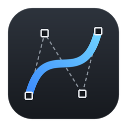
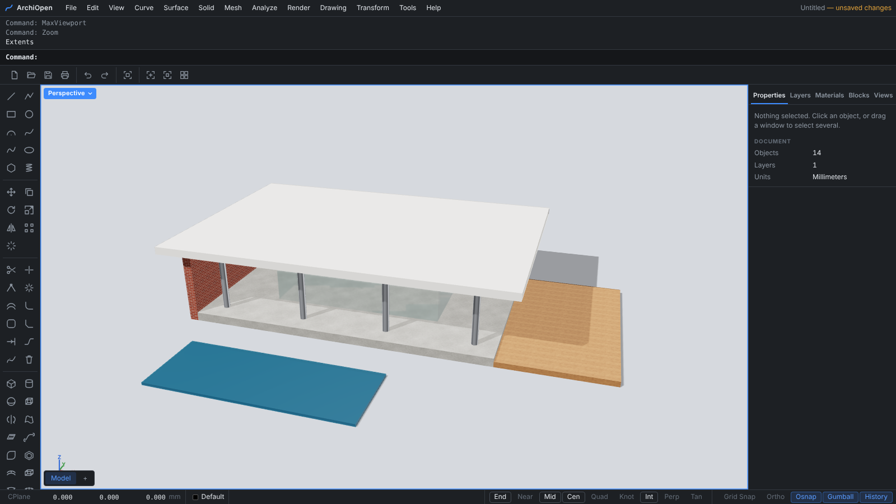
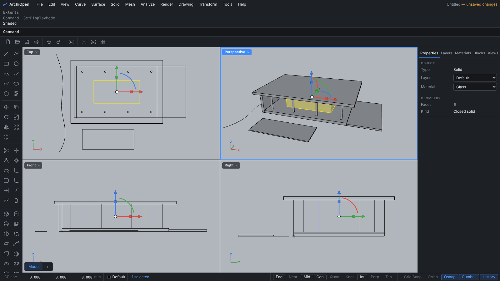
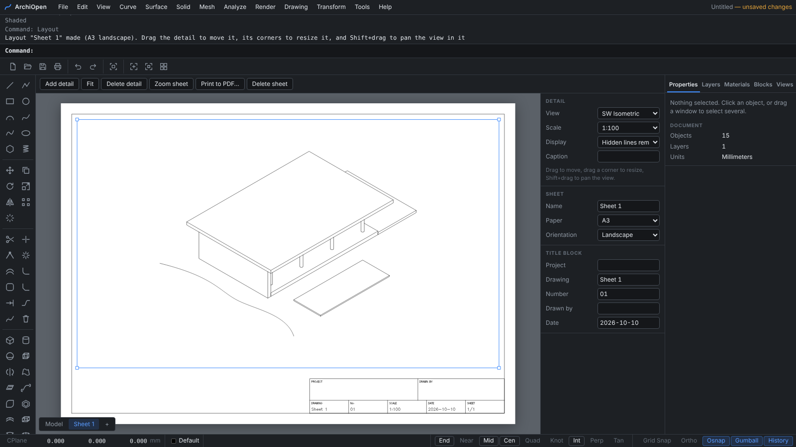
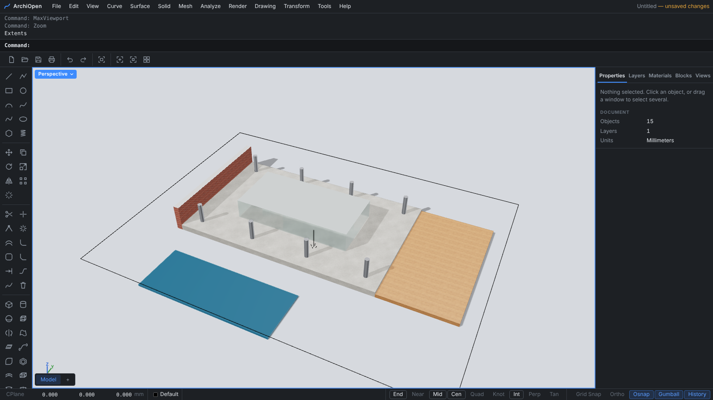
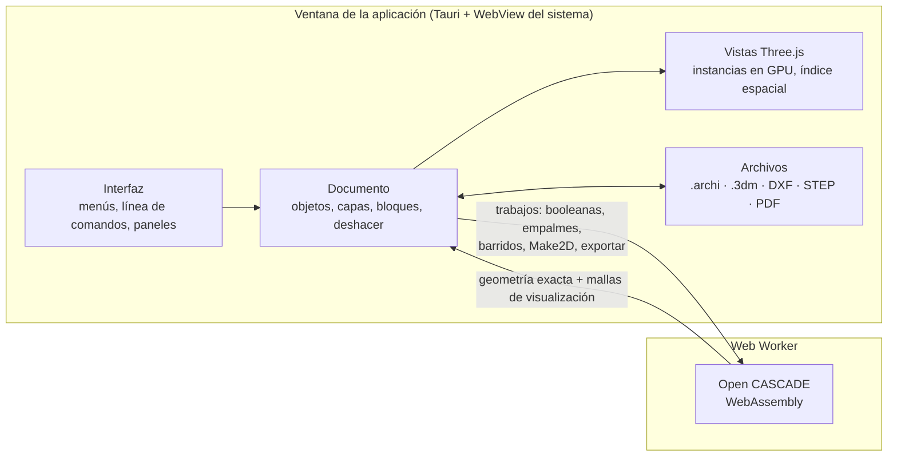

<div align="center">



# ArchiOpen

**Modelador NURBS de código abierto para arquitectura.**

Curvas, superficies y sólidos exactos, planos 2D y láminas, render, e intercambio con Rhino, STEP y
DXF, en una aplicación de escritorio ligera que se maneja con la línea de comandos.

[English](README.md) · **Español**

[](https://github.com/paugavilan8/ArchiOpen/actions/workflows/ci.yml)
[](https://github.com/paugavilan8/ArchiOpen/actions/workflows/desktop.yml)


[](LICENSE)

[Descargar](#descargar) · [Primeros pasos](docs/getting-started.es.md) · [Funciones](#funciones) · [Arquitectura](#arquitectura) ·
[Formatos](#formatos-de-archivo) · [Hoja de ruta](#hoja-de-ruta) · [Preguntas](#preguntas-frecuentes) · [Desarrollo](#desarrollo)

<br>



</div>

## Descripción

ArchiOpen sigue la forma de trabajar de los modeladores NURBS profesionales. Escribes un comando
(`Line`, `Loft`, `BooleanDifference`, `Make2D`…) o lo eliges en un menú o una barra de
herramientas, y el programa pide puntos, opciones y distancias. La geometría es exacta: las curvas
son NURBS y las superficies y sólidos son B-rep del núcleo
[Open CASCADE](https://dev.opencascade.org), así que lo que se exporta a Rhino o a STEP llega como
superficies, no como mallas.

**Lo más destacado**

- **Modelado:** curvas NURBS (también racionales), barridos, lofts, superficies por red de curvas,
  parches y transiciones; booleanas, empalmes y vaciados; historial de construcción que rehace las
  superficies al cambiar sus curvas.
- **Elementos constructivos:** muros, forjados, ventanas y puertas paramétricos por niveles, que se
  rehacen al cambiar sus líneas o sus parámetros.
- **Dibujo preciso:** referencias a objetos (End, Mid, Cen, Int, Perp, Tan…), coordenadas escritas,
  ortogonal, planos de construcción y gumball.
- **Planos:** `Make2D` con líneas ocultas, cotas asociativas, sombreados, tipos de línea y
  grosores, láminas con cajetín y salida a PDF vectorial y DXF.
- **Render:** materiales físicos y texturas, sol y sombras, oclusión ambiental e imágenes de hasta 4K.
- **Intercambio:** `.3dm` de Rhino con superficies exactas y bloques, STEP AP242, DXF con capas,
  bloques y cotas, STL, OBJ y glTF.
- **Rendimiento:** el núcleo geométrico trabaja en segundo plano, la selección usa un índice
  espacial y los bloques se dibujan con instancias en la GPU.

<table>
<tr>
<td width="50%"></td>
<td width="50%"></td>
</tr>
<tr>
<td align="center"><sub>Cuatro vistas, gumball y panel de propiedades</sub></td>
<td align="center"><sub>Lámina A3 con un detalle isométrico de líneas ocultas</sub></td>
</tr>
<tr>
<td colspan="2"></td>
</tr>
<tr>
<td colspan="2" align="center"><sub>Un plano de corte horizontal convierte la vista en una planta en 3D, con las secciones rellenas del color de cada material</sub></td>
</tr>
</table>

## Descargar

> [!NOTE]
> El instalador no necesita nada más: la interfaz, el núcleo geométrico y el lector de archivos de
> Rhino van dentro del ejecutable. Ver [¿Qué incluye el instalador?](#instalador)

**[Descarga la última versión](https://github.com/paugavilan8/ArchiOpen/releases/latest)** desde la
página de *Releases* (no hace falta cuenta de GitHub):

| Sistema | Archivo |
| --- | --- |
| Windows | `ArchiOpen_x.y.z_x64-setup.exe` (o el `.msi`) |
| macOS | `ArchiOpen_x.y.z_aarch64.dmg` |
| Linux | `ArchiOpen_x.y.z_amd64.AppImage` (o el `.deb` o el `.rpm`) |

Las novedades de cada versión están en el [registro de cambios](CHANGELOG.md) (en inglés).

**Actualizaciones.** Desde la versión 0.8.1 la aplicación de escritorio se actualiza sola: poco
después de abrirla busca una versión nueva y ofrece instalarla (Help > Check for Updates la busca
cuando se quiera). Las actualizaciones van firmadas y la aplicación comprueba la firma antes de
instalarlas.

**Primer arranque.** Los instaladores aún no llevan firma de código, así que Windows puede mostrar
"Windows protegió su PC" (elige *Más información* > *Ejecutar de todas formas*) y macOS puede
negarse a abrir la aplicación la primera vez (clic derecho > *Abrir*, o permitirla en Ajustes del
Sistema > Privacidad y seguridad).

Las versiones las compila y publica GitHub Actions por sí solo cuando se integra en `master` un
cambio de la versión de `package.json` (entonces se crea la etiqueta `vX.Y.Z`); subir esa etiqueta
también publica una. También se puede compilar el código más reciente a mano
desde el flujo [**Desktop app**](https://github.com/paugavilan8/ArchiOpen/actions/workflows/desktop.yml)
(**Run workflow**); el resultado aparece como artefacto de la ejecución, que sí requiere cuenta.

## Funciones

Despliega cada apartado para ver los detalles.

<details>
<summary><b>Interfaz y vistas</b></summary>
<br>

- Cuatro vistas (Top, Front, Right, Perspective) con rejilla, ejes y menú propio.
- Órbita (botón derecho en Perspective), encuadre (Mayús + botón derecho o botón central) y zoom
  con la rueda.
- Modos de visualización por vista: `Wireframe`, `Shaded`, `Ghosted` (superficies translúcidas),
  `X-Ray` (las aristas ocultas se ven a través) y `Rendered`, desde el menú de la vista o con
  `SetDisplayMode`.
- `CPlane` cambia el plano de construcción de la vista activa: nuevo origen, `3Point`, `Elevation`
  o `World`. Lo que se dibuja después usa ese plano.
- `NamedView` y `NamedCPlane` guardan y recuperan vistas y planos de construcción; el panel *Views*
  los lista.
- **Planos de corte** (`ClippingPlane`, menú *View*): todo lo que queda delante del plano se oculta,
  como en una sección o una planta en 3D. La flecha indica el lado visible y `Flip` le da la vuelta.
  Los sólidos cortados se rellenan del color de su material. El plano se mueve, gira y copia como
  cualquier objeto, y el corte se actualiza en directo. En el panel de propiedades se elige en qué
  vistas corta, y `EnableClippingPlanes` / `DisableClippingPlanes` activan o quitan todos los cortes
  de la vista activa. Lo cortado no se puede seleccionar ni sirve de referencia. Los planos de
  corte también cortan los dibujos: `Make2D` (los planos activos en la vista activa, opción
  `Clipping`), los detalles de las láminas (opción *Clipping* en el panel del detalle) y las vistas
  impresas. Las líneas de corte van a su propia capa, *Make2D Section*, y se imprimen con una
  plumilla más gruesa; en plantas y secciones, las caras cortadas de los sólidos se rellenan
  (*Make2D Section Fill*, opción `SectionFill`).
- Selección por clic, ventana (de izquierda a derecha) y captura (de derecha a izquierda), con un
  índice espacial que la mantiene inmediata en modelos con miles de objetos o mallas muy densas.
- Gumball sobre la selección: flechas para mover, arcos para girar (Mayús: pasos de 15°), cajas para
  escalar en un eje (Mayús: uniforme) y el centro para mover en el plano. Un clic sin arrastrar pide
  el valor exacto.
- Capas con color, visibilidad y bloqueo; panel de propiedades del objeto seleccionado.

</details>

<details>
<summary><b>Dibujo de precisión</b></summary>
<br>

- Coordenadas escritas: absolutas `x,y,z`, relativas `r dx,dy`, y longitud fija escribiendo un
  número antes de hacer clic.
- Referencias a objetos, desde la barra de estado (F3 las activa o desactiva todas):
  - `End`, `Mid`, `Cen`, `Quad` y `Near`;
  - `Knot`: los nudos de las curvas NURBS;
  - `Int`: el cruce de dos curvas, aristas o líneas de una malla. Si se cortan de verdad el punto es
    exacto, no el de las líneas con que se dibujan; si solo se cruzan en pantalla, se toma el punto
    de la primera;
  - `Perp` y `Tan`: el punto de una curva donde la línea desde el punto anterior es perpendicular o
    tangente, exacto en rectas, arcos, círculos y NURBS.
- Ortogonal (F8) y forzado a rejilla (F9).
- Arrastrar un objeto o un punto de control seleccionado lo mueve, con referencias a objetos.
- Puntos de control: `PointsOn` (F10) y `PointsOff` (F11) en polilíneas y curvas; se seleccionan,
  arrastran, mueven con el gumball o se borran.

</details>

<details>
<summary><b>Curvas, puntos y transformaciones</b></summary>
<br>

- Dibujo: `Line`, `Polyline`, `Rectangle`, `Circle`, `Arc`, `Curve` (por puntos de control),
  `InterpCrv` (que pasa por los puntos), `Ellipse` (exacta, como curva racional), `Polygon`
  (inscrito o circunscrito) y `Helix`. Las curvas racionales se leen y escriben exactas en `.3dm`,
  DXF y el núcleo.
- Edición de curvas: `Trim`, `Split`, `Join`, `Explode`, `Offset`, `Fillet`, `FilletCorners`,
  `Chamfer`, `Extend`, `BlendCrv` (continuidad de posición, tangencia o curvatura) y `Rebuild`
  (indica cuánto se separa de la original).
- `CurveBoolean`: se hace clic dentro de las regiones que encierran unas curvas y da su contorno:
  las regiones vecinas se unen, así que sirve para uniones, diferencias e intersecciones de curvas
  cerradas, y para partir regiones con curvas abiertas.
- Puntos: `Point`, `Points` y `Divide` (por número de tramos o por longitud); `SelPt` los selecciona.
- Transformaciones: `Move`, `Copy`, `Rotate`, `Scale`, `Mirror`, `Array` y `ArrayPolar`, y además:
  - `Scale1D` estira en una sola dirección y `Scale2D` solo en el plano de construcción. También
    estira superficies y sólidos, de forma exacta: sus NURBS se estiran con ellos (una esfera pasa
    a ser un huevo, un cilindro uno elíptico), igual que el tirador de escala del gumball en un eje;
  - `ArrayCrv`: copias a lo largo de una curva, por número o por distancia, girando con ella
    (`Freeform`), de pie respecto a la normal del plano de construcción (`Roadlike`) o sin girar;
  - `ProjectToCPlane`: aplana curvas, puntos, mallas, textos y sombreados sobre el plano de
    construcción;
  - deformaciones: `Twist` (torsión alrededor de un eje), `Taper` (de una escala a otra a lo largo
    de un eje), `Bend` (flexión de un eje en un arco de la misma longitud) y `Flow` (de lo largo de
    una curva base a lo largo de una curva destino, estirando o no). Funcionan con curvas, puntos,
    mallas, superficies y sólidos; las superficies y sólidos siguen siendo NURBS, refinadas y
    ajustadas para seguir la deformación de cerca (una barra torcida o doblada conserva su volumen
    con un error menor de 1e-6). `CageEdit` mete objetos en una jaula de puntos (de 2 a 6 por lado):
    al mover los puntos, los objetos se deforman con suavidad; borrando la jaula se quedan como estén.

  Y herramientas para colocar objetos respecto a otros (menú *Transform*):
  - `Orient`: lleva un punto de referencia a un punto de destino y, con un segundo par, gira la
    línea de referencia sobre la de destino, también en 3D. Opciones `Copy` y `Scale` (`No`,
    `Uniform`, u `OneDirection` para estirar solo a lo largo de la línea).
  - `Orient3Pt`: coloca objetos con tres puntos de referencia sobre tres de destino (origen,
    dirección y plano) sin deformarlos.
  - `Align`: alinea objetos por sus cajas envolventes (`Left`, `Right`, `Top`, `Bottom`,
    `HorizontalCenter`, `VerticalCenter`, `Center`) entre sí o con un punto. Los grupos se mueven
    enteros.
  - `Distribute`: reparte tres o más objetos a lo largo de X, Y o Z, por centros o con huecos
    iguales, entre los dos extremos o con una separación fija.

</details>

<details>
<summary><b>Superficies, sólidos e historial</b></summary>
<br>

- Sólidos y superficies: `Box`, `Cylinder`, `Sphere`, `Cone`, `TCone` (truncado), `Torus`,
  `Pyramid` (con los lados que se quiera), `ExtrudeCrv` (con opción `Solid`),
  `Revolve`, `Loft`, `PlanarSrf`, `BooleanUnion`, `BooleanDifference`, `BooleanIntersection`,
  `FilletEdge`, `ChamferEdge`, `Sweep1`, `Shell`, `Section` y `Contour`. `Explode` separa una polisuperficie en
  caras y `Join` las vuelve a unir.
- Superficies avanzadas:
  - `Sweep2`: barre perfiles a lo largo de dos carriles, interpolando entre varios perfiles;
  - `NetworkSrf`: superficie a partir de una red de curvas en dos direcciones;
  - `Patch`: superficie ajustada a un contorno cerrado y a las curvas interiores;
  - `EdgeSrf` (de dos a cuatro curvas de borde) y `SrfPt` (de tres o cuatro esquinas);
  - `BlendSrf`: superficie de transición entre aristas de dos superficies, tangente a ambas;
  - `FilletSrf`: empalme de radio constante entre dos superficies o caras, del lado elegido, con
    opción de recortar ambas hasta él. No hace falta que se toquen;
  - `MatchSrf`: modifica una superficie junto a uno de sus bordes para que encaje con el borde de
    otra, con continuidad de posición, tangencia o curvatura (`Position`, `Tangency`, `Curvature`;
    una cara recortada se ajusta sobre su superficie completa);
  - `ExtendSrf`: alarga una superficie más allá del borde elegido, siguiendo como iba (un plano
    sigue plano, un cilindro sigue su círculo);
  - `Pipe`: tubo a lo largo de curvas, con radio inicial y final y opción de cerrarlo como sólido;
  - `RailRevolve`: un perfil girado alrededor de un eje mientras uno de sus extremos sigue una curva
    carril, para cúpulas y cubiertas sobre plantas ovaladas o irregulares.
- Edición de superficies:
  - `Split` y `Trim` funcionan con superficies, polisuperficies y sólidos, cortando con curvas
    (proyectadas tal como se ven en la vista) o con otras superficies y sólidos. Los sólidos se
    parten en sólidos.
  - `Cap`, `ExtrudeSrf`, `OffsetSrf` (con opción `Solid`) y `ExtractSrf`.
  - `Untrim` quita los agujeros de una cara (`HolesOnly`) o todos sus recortes, hasta la superficie
    completa; el resto de la polisuperficie se vuelve a unir.
  - `UnrollSrf` desarrolla caras planas, cilíndricas y cónicas en patrones de corte (contornos en el
    plano XY, con las longitudes conservadas). Las caras que comparten una arista recta siguen
    unidas como una red para plegar; con `Explode` cada cara va por separado. Las demás caras se
    omiten y se avisa.
  - Curvas a partir de superficies: `Project`, `Pull`, `Intersect`, `DupBorder` y `DupEdge`.
- Historial de construcción (activo por defecto, como *Record History* de Rhino): las superficies
  hechas con `ExtrudeCrv`, `Revolve`, `Loft`, `Sweep1`, `Sweep2`, `Pipe`, `PlanarSrf`, `EdgeSrf`,
  `NetworkSrf` y `Patch` se rehacen al mover o editar sus curvas, en el mismo paso de deshacer.
  También `SelChildren`, `SelParents` y `HistoryPurge`.

</details>

<details>
<summary><b>Elementos constructivos</b></summary>
<br>

- `WallType` (o la opción `Type` de `Wall`) da a los muros una composición por capas, de su cara
  izquierda (mirando a lo largo de su línea) a la derecha: fachada de ladrillo con cámara (ladrillo
  cara vista, aislamiento, ladrillo hueco, yeso), hormigón con aislamiento, tabique o entramado de
  madera. El muro se divide en un sólido por capa, así que las plantas y secciones dibujan las líneas
  entre ellas, y las mediciones cuentan cada capa por su material.
- `CurtainWall` dibuja un muro cortina a lo largo de una línea punto a punto, de la altura del
  nivel actual: montantes como mucho a `Spacing`, travesaños como mucho a `Rows` (`Mullion` y
  `Depth` dan su tamaño) y vidrio entre ellos. Su perfilería y su vidrio son dos objetos hechos de
  la misma línea, que se rehacen al cambiarla; al exportar a IFC son un solo IfcCurtainWall.
- `Wall` dibuja muros punto a punto (`Close` para cerrar un recinto) o a lo largo de curvas ya
  dibujadas (`Curve`), con `Thickness` (espesor) y `Justification` (`Center`, `Left` o `Right`
  respecto a la línea). Las esquinas se ingletean y las líneas curvas dan muros curvos. Los muros
  toman la altura del nivel actual.
- Los muros se unen solos: dos muros cuyos extremos coinciden se ingletean en una esquina limpia
  (L), y un muro que acaba sobre otro (en su línea o en su cara) se detiene en esa cara (T), sean
  cuales sean sus espesores y justificaciones. Las uniones se actualizan al mover o cambiar
  cualquiera de los dos muros, y se deshacen con ellos.
- `Slab` crea un forjado o una cubierta plana a partir de esquinas o de curvas cerradas, con la cara
  superior en el contorno y el espesor (`Thickness`) por debajo.
- `Roof` crea una cubierta inclinada sobre un contorno dibujado a la altura de coronación de los
  muros del nivel actual (o sobre curvas cerradas). `Type`: `Hip` (a cuatro aguas), `Gable` (a dos
  aguas, inclinados los lados largos, con hastiales en los extremos) o `Shed` (a un agua); opciones
  `Pitch` (pendiente), `Overhang` (vuelo del alero) y `Thickness` (espesor). Los contornos convexos
  admiten cualquier tipo; las plantas de esquinas en ángulo recto, como en L, T o U, admiten
  cubiertas a cuatro aguas, con limahoyas en las esquinas interiores, y a dos aguas, con cumbreras
  que se cruzan. La cubierta apoya sobre el contorno (su cara inferior queda ahí a la altura del
  alero), y los muros que quedan debajo con la coronación a esa altura suben hasta su cara inferior,
  cerrando los hastiales y siguiendo los cambios de la cubierta.
- `Stair` crea una escalera desde el primer peldaño hasta el último, salvando la altura del nivel
  actual. Una línea recta da un tramo; cada quiebro de la línea es un rellano cuadrado entre tramos
  (una escalera en L tiene uno; una en U, dos juntos, dibujada como una línea que sube, cruza y
  vuelve). Se crea con `Width` (ancho) y `Risers` (contrahuellas; automático: unos 175 de tabica), y
  avisa si los peldaños no son cómodos (dos tabicas y una huella entre 600 y 650). Con `Opening`
  (activo por defecto) abre su hueco en el forjado al que llega: sus tramos y rellanos, 50 más
  grandes por cada lado. `StairOpening` lo vuelve a abrir para las escaleras elegidas, y al editar
  la altura de un nivel sus escaleras se rehacen para salvarla, con sus huecos.
- `Column` coloca pilares rectangulares o circulares, de la altura del nivel actual.
- `Railing` coloca barandillas a lo largo de una línea dibujada punto a punto (bordes de forjado,
  balcones) o, con la opción `Stair`, en escaleras: siguiendo los bordes de los peldaños de cada
  tramo (`Sides` `Both`, `Left` o `Right`) y rodeando los bordes libres de los rellanos. Llevan
  postes como mucho cada 1200, pasamanos a la altura `Height` y `Style` `Bars` (barrotes
  verticales) o `Rails` (tres travesaños), en acero cepillado en la capa *Railings*. Las de una
  escalera la siguen cuando cambian su línea o sus parámetros.
- `Window` y `Door` abren huecos donde se hace clic en un muro, con `Width` (ancho), `Height`
  (alto) y `Sill` (altura del alféizar), y los cierran: las ventanas llevan marco y vidrio y las
  puertas marco y hoja, cada pieza con su material en las capas *Windows*, *Glazing* y *Doors*
  (`Frame=No` deja el hueco vacío). Siguen al muro al mover su línea o cambiar sus parámetros, y
  desaparecen al quitar el hueco.
- Los huecos también se dibujan en planta, en la capa *Plan Symbols* a la altura del suelo: la hoja
  de la puerta abierta en perpendicular al muro con el arco de su barrido, y el marco y el vidrio
  de las ventanas. La puerta abre hacia el lado del muro en el que se hizo clic, con las bisagras en
  el extremo que indica `Hinge`; desde el panel de propiedades se invierte el sentido (⇅) o el lado
  de las bisagras (⇄).
- Muros y forjados conservan su línea (en la capa *Construction*): al moverla o editarla se rehacen.
  El espesor, la altura, la justificación y los huecos (y los parámetros de cubiertas, escaleras y
  pilares) se cambian en el panel de propiedades, en un solo paso de deshacer. Si se mueve el sólido directamente, pasa a ser un sólido normal, como con el
  historial de construcción.
- `WallDimensions` acota los muros en planta, como en un plano de arquitectura: por la cara exterior
  de cada tramo recto de los muros de fachada, una cadena de esquina a esquina pasando por los bordes
  de los huecos y, más afuera, la cota total (los muros interiores no se acotan). Las cotas llevan
  marcas oblicuas, van en la capa *Dimensions* y quedan agrupadas.
- `Room` rotula estancias: al hacer clic dentro de una se crea su contorno (entre los contornos de
  los muros en planta, rodeando los pilares y sin contar los huecos) en la capa *Rooms* y un rótulo
  con su nombre y su superficie útil (m² o ft² según las unidades), centrado donde se hizo clic y
  agrupado. El contorno sirve para hacer el suelo de la estancia con `Slab` (opción `Curve`). Si la
  estancia no está cerrada, se avisa.
- `Floor` coloca el pavimento de las estancias en las que se hace clic (o sobre curvas cerradas):
  `Thickness` (espesor) y `Material` (`Wood`, `CeramicTiles`, `Marble`, `Concrete`), rodeando los
  pilares. `Skirting` coloca el rodapié de las estancias, a lo largo de los muros y alrededor de los
  pilares, interrumpido en las puertas, con `Height` (altura) y `Thickness` (espesor). Ambos
  conservan su contorno en la capa *Construction* y sus parámetros en el panel de propiedades.
- `Furniture` coloca mobiliario y equipamiento de una pequeña biblioteca: `DoubleBed` (cama doble),
  `SingleBed` (individual), `Sofa`, `Armchair` (sillón), `DiningTable` (mesa de comedor), `Chair`,
  `Desk` (escritorio), `Wardrobe` (armario), `KitchenCounter` (bancada de cocina), `Fridge`, `WC`,
  `Washbasin` (lavabo), `Bathtub` (bañera) y `ShowerTray` (plato de ducha). Cada pieza se crea como
  bloque la primera vez y se coloca por el centro de su parte trasera (contra la pared), girándola
  después hacia un punto o un ángulo; los sanitarios van en la capa *Sanitary* en cerámica.
- `Elevations` dibuja los cuatro alzados del edificio (sur, este, norte y oeste) en fila bajo el
  modelo, y `Section` dibuja una sección por una línea trazada en planta, mirando hacia el lado
  indicado, con los muros, forjados y cubiertas cortados en trazo grueso y rellenos, junto al
  modelo. Cada vista lleva línea de suelo y título y queda agrupada, lista para las láminas; la
  sección añade además su marca en planta (línea de corte, flechas y letras A, B...). Cada vista
  lleva también sus alturas: una cota de nivel (nombre y altura, ±0.00 en el cero) en cada nivel y
  en la coronación a la izquierda, y a la derecha una cadena de cotas por los antepechos y dinteles
  de los huecos que se ven y otra de nivel a nivel.
- `Schedule` dibuja la tabla de carpintería (una fila por tipo, marcados D1, D2... y W1, W2..., con
  ancho, alto, antepecho, niveles y número de unidades) y la de superficies (cada estancia rotulada
  con su nivel y superficie útil, el total de cada nivel y el del edificio) en una capa Schedules,
  listas para las láminas. `UpdateDrawings` las vuelve a hacer en su sitio a partir del modelo. Su
  opción `Quantities` dibuja las mediciones de los elementos por nivel y material: muros (longitud y
  superficie de una cara menos huecos), forjados (superficie menos huecos), cubiertas (superficie en
  planta), pilares, escaleras, barandillas (longitud), pavimentos, rodapiés, puertas y ventanas, con
  sus volúmenes, en metros. `ExportQuantities` las guarda en un CSV para una hoja de cálculo.
- `Tags` coloca la marca de cada puerta y ventana (D1, W1... como en la tabla de carpintería)
  junto a ella en planta, en una capa Opening Tags; `UpdateDrawings` las vuelve a colocar y
  `DrawingSet` las añade si faltan. En las plantas de un juego de planos, los textos como los
  rótulos de estancias, las etiquetas y las cotas salen solo en la planta de su nivel; las marcas
  de sección salen en todas.
- `DrawingSet` coloca de una vez los planos del edificio en láminas A3, cada una con su cajetín
  (proyecto, título, número A-01, A-02..., escala y fecha): una planta por cada nivel con algo
  construido, cortada a 1,2 sobre su suelo y sin los niveles de debajo (todas a la misma escala, con
  líneas ocultas y el corte relleno), los cuatro alzados (se dibujan antes si faltan), las
  secciones y las tablas (también se dibujan antes si faltan). Cada lámina toma la mayor escala
  normalizada que cabe, y son láminas normales, para retocarlas o exportarlas a PDF. Cada detalle
  de planta lo cortan solo los planos de corte de su nivel, que no cortan ninguna vista en
  pantalla. `UpdateDrawings` vuelve a dibujar los alzados, las secciones y las tablas a partir del
  modelo tal como está, cada uno en su sitio, para que las láminas muestren los cambios.
- `Terrain` crea el terreno de la parcela a partir de puntos y curvas de nivel (curvas a su cota,
  muestreadas cada `Spacing`), como una malla en la capa Terrain: la triangulación de Delaunay de
  los puntos en planta, cada uno a su cota. `Boundary` la recorta a una curva cerrada, `MaxEdge`
  quita los triángulos largos de los bordes cóncavos y `Base` le da laterales y fondo a una
  profundidad bajo su punto más bajo, para que sea un sólido que las secciones cortan y rellenan.
- `Level` añade, edita y elimina niveles (nombre, cota y altura entre plantas) y elige el actual, lo
  que lleva los planos de construcción a su cota. Los niveles se guardan con el modelo.
- Para todo lo demás son sólidos normales: los planos de corte los convierten en plantas y secciones
  con el corte relleno, y `Make2D`, las láminas, el render y la exportación funcionan igual.

</details>

<details>
<summary><b>Mallas</b></summary>
<br>

- `Mesh` convierte superficies y sólidos en mallas (`Coarse`, `Medium` o `Fine`); `MeshBox`,
  `MeshSphere`, `MeshCylinder` y `MeshPlane` crean mallas con el número de caras indicado.
- Edición: `Weld`, `Unweld`, `Flip`, `UnifyMeshNormals`, `FillMeshHoles`, `Join` y `Explode`. Los
  vértices se editan como puntos de control.
- `MeshToNURB` convierte una malla en una polisuperficie de caras planas (un sólido si es cerrada).
- Se ven suaves con aristas vivas en los pliegues; el panel de propiedades muestra vértices, caras,
  si es cerrada, área y volumen.
- `Make2D`, `Section` y `Contour` también funcionan con mallas.

</details>

<details>
<summary><b>Análisis</b></summary>
<br>

- Medición: `Distance`, `Length`, `Angle`, `Radius`, `Area` y `Volume` (con centroides). Las
  medidas de superficies y sólidos son exactas en caras planas, cilíndricas, cónicas, esféricas,
  tóricas, B-splines de grado bajo y extrusiones.
- `BoundingBox` en coordenadas del mundo o del plano de construcción.
- `CurvatureGraphOn` / `CurvatureGraphOff`: peines de curvatura que se actualizan al editar.
- Análisis `Zebra` y `DraftAngleAnalysis` en superficies y mallas; `ShowEdges` resalta los bordes
  abiertos.
- `What` describe objetos; `Check` informa de geometría no válida, aristas de más de dos caras,
  caras degeneradas y curvas sin longitud; `SelBadObjects` las selecciona.

</details>

<details>
<summary><b>Render y materiales</b></summary>
<br>

- Modo `Rendered`: materiales físicos con reflejos de un entorno de estudio, sol con sombras suaves
  y sombra sobre el suelo. Los objetos sin material se ven como una maqueta de arcilla mate,
  ligeramente teñida por el color de su capa.
- Materiales a partir de presets (yeso, hormigón, madera, ladrillo, azulejo, mármol, acero, vidrio,
  agua…), con color, rugosidad, metal y transparencia editables, asignados a objetos o capas.
- Texturas: patrones generados (`Wood`, `Brick`, `Tiles`, `Concrete`, `Marble`) o imágenes (JPEG,
  PNG, WebP), aplicadas por proyección de caja a su tamaño real.
- `Sun`: azimut, altura, intensidad, fondo y sombras en el suelo.
- `Render` genera imágenes a 1280 × 720, 1920 × 1080, 3840 × 2160 o al tamaño de la vista, con
  suavizado y oclusión ambiental. `ViewCaptureToFile` guarda la vista tal como se ve.

</details>

<details>
<summary><b>Planos, cotas y láminas</b></summary>
<br>

- `Make2D` proyecta la selección con eliminación de líneas ocultas en curvas planas: plantas,
  alzados y axonometrías, o las cuatro vistas a la vez (`FourView`), con las líneas ocultas si se
  quiere. Con planos de corte dibuja plantas y secciones: los sólidos se cortan y el contorno del
  corte va a la capa *Make2D Section*.
- Textos y cotas con una tipografía técnica de un solo trazo: `Text`, `Dim`, `DimAligned`,
  `DimRadius`, `DimDiameter`, `DimAngle` y `Leader`, con flechas o trazos oblicuos de arquitectura.
  Las cotas se actualizan al cambiar su geometría, y su texto, altura y decimales se editan en el
  panel de propiedades.
- `Hatch` rellena curvas cerradas planas (las interiores son huecos) con un relleno sólido o un
  patrón.
- Tipos de línea y grosores por capa.
- `ExportPDF` imprime la vista activa en PDF vectorial a un tamaño de papel y una escala;
  `ExportDXF` escribe DXF R12.
- Láminas (`Layout`): vistas de detalle con su propia vista, escala y modo de dibujo (alámbrico o
  con líneas ocultas), títulos y cajetín. Las líneas ocultas solo se recalculan cuando cambia lo que
  muestra el detalle. `ExportPDF` imprime una lámina o todas en un PDF de varias páginas.

</details>

<details>
<summary><b>Bloques, grupos y organización</b></summary>
<br>

- Bloques: `Block`, `Insert`, `BlockEdit` (edición en su sitio que actualiza todas las copias,
  también las anidadas), `Explode` y `Purge`. El panel *Blocks* lista las definiciones con miniatura
  y número de copias. Las copias se dibujan con instancias en la GPU, así que cientos de copias
  cuestan casi lo mismo que una.
- Archivos vinculados, para trabajar un proyecto por partes (como sesiones de trabajo o referencias
  externas): `Link` coloca otro modelo (`.archi` o `.3dm`) en este como un bloque ligado a su
  archivo, con sus capas bajo el nombre del archivo; `UpdateLinks` vuelve a leer los archivos cuando
  cambian; `Unlink` los incorpora a este modelo. Los bloques vinculados no se editan aquí (se cambia
  su archivo), y su contenido también se guarda, así que el modelo los sigue mostrando si falta un
  archivo. La aplicación de escritorio vuelve a leerlos por su ruta; en el navegador, solo durante la
  sesión en que se vincularon.
- Grupos: `Group`, `Ungroup`, `AddToGroup` y `RemoveFromGroup`.
- `Hide`, `Show`, `HideSwap`, `Isolate`, `Unisolate`, `Lock` y `Unlock`.
- Comandos de selección: `SelCrv`, `SelSrf`, `SelPolysrf`, `SelClosedPolysrf`, `SelOpenPolysrf`,
  `SelBlockInstance`, `SelAnnotation`, `SelDim`, `SelText`, `SelHatch`, `SelLayer`, `SelDup`,
  `SelLast`, `SelPrev` e `Invert`.
- **Copiar y pegar** (menú *Edit*): `Ctrl+C`, `Ctrl+X` y `Ctrl+V` (`CopyToClipboard`, `Cut`,
  `Paste`) pasan objetos por el portapapeles del sistema, entre ventanas y archivos, con sus capas,
  materiales, grupos y bloques. Se pegan en la misma posición y se escalan si el archivo de destino
  tiene otras unidades.

</details>

<details>
<summary><b>Archivos</b></summary>
<br>

- `.archi` (JSON) es el formato propio. La sesión se recupera sola si la aplicación se cierra de
  forma inesperada.
- **Autoguardado en carpeta** (app de escritorio, `Autosave`, menú *File*): cada 5 minutos, mientras
  haya cambios sin guardar, se guarda una copia del modelo en los datos locales de la aplicación, nunca
  en una carpeta sincronizada como OneDrive (`AppData\Local\ArchiOpen\Autosave` en Windows,
  `~/Library/Application Support/ArchiOpen/Autosave` en macOS, `~/.local/share/ArchiOpen/Autosave` en
  Linux), como
  `<nombre> <fecha> <hora>.archi`. Se conservan las 10 copias más recientes de cada modelo. El
  intervalo, el número de copias y la carpeta son opciones; `SaveNow` guarda una copia al momento y
  `Recover` muestra las copias y abre una como modelo sin guardar.
- **`.3dm` de Rhino** (con [rhino3dm](https://github.com/mcneel/rhino3dm)):
  - Lectura: curvas, polisuperficies, superficies y extrusiones (reconstruidas como geometría exacta
    y editable, con recortes y agujeros), mallas, puntos, capas, unidades, bloques (también anidados
    y con polisuperficies dentro) y textos. El formato de los textos no se conserva. Los SubD, las
    cotas, las directrices y los *text dots* aún no se leen; se avisa de cuántos hay.
  - Escritura: superficies y sólidos exactos como polisuperficies recortadas de Rhino (planos,
    superficies de revolución, extrusiones y NURBS), bloques como definiciones de Rhino escritas una
    sola vez, y capas anidadas. Lo que no tiene equivalente exacto se escribe como malla y se avisa.
    Los textos y las cotas se escriben como curvas.
  - `Save` nunca sobrescribe un `.3dm` abierto: guarda un `.archi`.
- **STEP** (AP242): `ExportSTEP` escribe sólidos, superficies y curvas exactos con el nombre y el
  color de su capa y las unidades; `ImportSTEP` los añade a la capa actual, convertidos a las
  unidades del modelo.
- **DXF** (ASCII, de R12 a 2018): capas con color, tipo de línea y grosor; líneas, polilíneas con
  arcos, círculos, arcos, elipses, splines, caras 3D, textos, cotas (que siguen midiendo),
  directrices, sombreados y bloques (que siguen siendo bloques). No se leen DXF binarios.
- **DWG** (aplicación de escritorio): `Open` e `Import` leen planos DWG mediante el
  [ODA File Converter](https://www.opendesign.com/guestfiles/oda_file_converter), gratuito y que se
  instala aparte: ArchiOpen lo encuentra, convierte el plano a DXF por detrás y lo lee. DWG es un
  formato cerrado; así ArchiOpen queda libre de sus licencias. Si el conversor está instalado en
  otro sitio, se indica su ruta en la variable `ARCHIOPEN_ODA_CONVERTER`.
- Importación y exportación de **STL** y **OBJ**.
- Exportación a **glTF** (`.glb`) con `ExportGLTF`: superficies, sólidos, mallas y bloques con sus
  materiales de render, en metros y con Y hacia arriba, para visores web, Blender, Unreal, Unity,
  Twinmotion y realidad aumentada.
- **IFC** (IFC4), para programas BIM como Revit, ArchiCAD o BIMcollab:
  - `ExportIFC` escribe un proyecto con emplazamiento, edificio y una planta por nivel. Los muros,
    forjados, cubiertas, escaleras, pilares, barandillas, pavimentos y rodapiés pasan a su entidad
    IFC, y cada puerta y ventana a un IfcDoor o IfcWindow con sus medidas. El mobiliario pasa a
    IfcFurniture, las estancias a espacios con su superficie, y el resto a objetos genéricos. Las
    formas se escriben como caras trianguladas, en metros. Un muro dibujado en anillo o en varios
    tramos se escribe como un muro por cada lado, con las esquinas a inglete.
  - `Open` e `Import` leen archivos IFC (con [web-ifc](https://github.com/ThatOpen/engine_web-ifc)).
    Los muros rectos de grosor constante pasan a ser muros de ArchiOpen sobre su eje, unidos donde
    se encuentran, con sus puertas y ventanas como huecos (con marcos y vidrios); los forjados
    planos pasan a ser forjados sobre su contorno, con sus huecos. Todo se puede editar como si se
    hubiera dibujado aquí. El resto (muros curvos o inclinados, cubiertas, mobiliario...) entra
    como mallas en una capa por clase, con los colores del archivo y los espacios en una capa
    oculta. `Open` toma además las plantas como niveles. Al abrir, el mensaje dice por qué algún
    muro o forjado se ha quedado como malla. Probado con el FZK-Haus de ArchiCAD (9 de sus 13
    muros editables; el resto son hastiales) y un ejemplo de Revit (16 de 17).

</details>

<details>
<summary><b>Scripts</b></summary>
<br>

`RunScript` (menú *File*) ejecuta un archivo JavaScript que maneja el modelador, para automatizar
trabajo repetitivo; `Last` vuelve a ejecutar el último. Un script se ejecuta como el cuerpo de una
función asíncrona, con `archi` y `Vector3` disponibles:

| | |
| --- | --- |
| `await archi.command(nombre, ...respuestas)` | Ejecuta un comando con sus respuestas en orden (`''` es Enter; si se acaban, Enter hasta que termina). Devuelve los ids que deja seleccionados (lo que ha creado); un error del comando detiene el script. |
| `archi.add(geometría, capa?)`, `archi.remove(ids)` | Añade geometría (una curva, malla o punto) a una capa por su nombre, o borra objetos. |
| `archi.objects(filtro?)` | Los objetos: id, tipo, capa, y el comando y los parámetros de los que tienen historial. |
| `archi.select(ids)` | Selecciona objetos, para los comandos que actúan sobre la selección. |
| `archi.setParams(id, parámetros)` | Cambia los parámetros de un objeto con historial (`openings`, `thickness` o `height` de un muro, ...); se vuelve a generar, como desde Properties. |
| `archi.levels()`, `archi.setLevel(nombre)` | Los niveles, y el actual: los puntos que se escriben en los comandos se miden desde su suelo (`w` delante de un punto, como `w0,0,6400`, da coordenadas absolutas). |
| `await archi.step(cambios)` | Varios cambios como un solo paso de deshacer. |
| `archi.v(x, y, z)`, `archi.log(...)`, `archi.doc` | Un punto, una línea en el historial y el propio documento. |
| `archi.param(nombre, valor, { min, max, step })` | Un parámetro, con su deslizador al ejecutarlo con `Parametric`. |

`Parametric` (menú *File*) ejecuta un script cuyos parámetros tienen deslizadores en un pequeño
panel: al soltar un deslizador, lo que hizo el script se rehace con el nuevo valor, como un solo
paso de deshacer, al estilo de las herramientas de programación visual. `Bake` conserva el
resultado como objetos normales y `Discard` lo quita.

Hay ejemplos en [examples/scripts](examples/scripts): una retícula de pilares, una torre de varias
plantas y una torre que gira, con deslizadores para sus plantas, tamaño y giro. Los scripts tienen el mismo acceso que la aplicación: ejecuta solo los que sean de fiar.

</details>

<details>
<summary><b>Asistente de IA (MCP)</b></summary>
<br>

ArchiOpen se puede manejar desde Claude, o desde cualquier otro cliente
[MCP](https://modelcontextprotocol.io): pides con palabras un edificio o sus planos, y el asistente
ejecuta los comandos en tu modelo, mira una imagen del resultado y lo corrige. El
[servidor MCP](mcp/README.md) funciona en tu ordenador; la conexión se activa en la app con
`McpConnect` (menú *File > Connect AI Assistant*), y la barra de estado indica cuándo hay un
asistente conectado. Sus herramientas describen el modelo, ejecutan comandos y scripts, cambian los
parámetros de los elementos, capturan vistas, abren, guardan y exportan archivos (IFC, PDF, DXF,
mediciones) y deshacen. Consulta [mcp/README.md](mcp/README.md) para configurarlo en Claude Desktop o
Claude Code.

</details>

<details>
<summary><b>Otros comandos y alias</b></summary>
<br>

- `PointsOn`, `PointsOff`, `Delete`, `SelAll`, `SelNone`, `Undo`, `Redo`, `Zoom`, `MaxViewport`,
  `Snap`, `Ortho`, `Osnap`, `Units`, `New`, `Open`, `Save`, `SaveAs`, `Import`, `Export`,
  `ImportSTEP` y `ExportSTEP`.
- Alias: `M`, `RO`, `SC`, `MI`, `AR`, `AP`, `TR`, `J`, `X`, `OF`, `F`, `REC`, `A`, `U`, `Z`,
  `ZE`, `ZEA`, `ZS`, `EXT`, `REV`, `BU`, `BD`, `BI`, `FE`, `SW`, `H`, `B`, `I`, `G` y `UG`.

</details>

## Arquitectura



- **Comandos:** pequeñas funciones asíncronas que piden puntos, objetos u opciones y modifican el
  documento. Cada comando se deshace en un solo paso.
- **Documento:** las curvas son NURBS evaluadas en TypeScript. Las superficies y sólidos se guardan
  en el formato exacto de Open CASCADE, junto con una malla que solo sirve para verlos.
- **Núcleo geométrico:** las operaciones pesadas se ejecutan en un Web Worker con Open CASCADE
  compilado a WebAssembly, así que la ventana sigue respondiendo y `Esc` cancela un cálculo largo.
  Cada trabajo libera los objetos del núcleo que ha creado, y el worker se sustituye sin que se note
  si su memoria crece demasiado.
- **Vistas:** Three.js dibuja en la GPU. Una jerarquía de volúmenes envolventes de dos niveles hace
  que el clic, la selección por ventana y las referencias solo miren lo que está cerca del cursor.
- **Aplicación de escritorio:** [Tauri](https://tauri.app) empaqueta todo en un ejecutable nativo
  que usa el motor web del sistema (WebView2 en Windows), por eso el instalador ocupa decenas de
  megas y no cientos.

## Formatos de archivo

| Formato | Abrir / importar | Guardar / exportar | Notas |
| --- | :---: | :---: | --- |
| `.archi` | Sí | Sí | Formato propio (JSON): modelo, láminas, materiales e historial |
| `.3dm` de Rhino | Sí | Sí | Superficies y sólidos exactos en los dos sentidos, bloques como bloques, textos al abrir; SubD y cotas aún no se leen |
| STEP `.step` `.stp` | Sí | Sí | AP242, B-rep exacto, con capas, colores y unidades |
| DXF | Sí | Sí | ASCII R12–2018: capas, bloques, cotas, textos, sombreados |
| DWG | Sí | — | Aplicación de escritorio, mediante el ODA File Converter gratuito |
| STL / OBJ | Sí | Sí | Mallas; las superficies se exportan trianguladas |
| glTF `.glb` | — | Sí | Triángulos con materiales de render, en metros |
| PDF | — | Sí | Vectorial, con grosores y tipos de línea; láminas en varias páginas |
| PNG | — | Sí | `Render` y `ViewCaptureToFile` |

## Hoja de ruta

- [x] Referencias `Int`, `Perp`, `Tan` y `Knot`
- [x] Planos de corte en directo con secciones rellenas
- [x] Planos de corte en láminas, `Make2D` y PDF
- [x] `Orient`, `Orient3Pt`, `Align` y `Distribute`
- [x] Bloques y textos de `.3dm`; bloques exportados como bloques
- [ ] Cotas y SubD de `.3dm`
- [x] Copiar y pegar entre archivos
- [x] `ChamferEdge` y `UnrollSrf`
- [x] `Untrim` y `RailRevolve`
- [x] `FilletSrf` y `MatchSrf`
- [ ] Deformaciones: `Bend`, `Twist`, `Taper`, `Flow`, `Cage`
- [ ] Modelado SubD
- [x] Elementos constructivos: muros, forjados, ventanas, puertas y niveles
- [x] Carpinterías de ventanas y puertas: marcos, vidrios y hojas
- [x] Uniones de muros (L y T)
- [x] Cubiertas (a cuatro, dos y un agua), escaleras rectas y pilares
- [x] Muros hasta la cubierta
- [x] Escaleras con rellano (en L y en U)
- [x] Cubiertas sobre plantas en L, T y U
- [x] Barandillas en escaleras y bordes de forjado
- [x] Cotas automáticas de muros y huecos en planta
- [x] Rótulos de estancias con superficie
- [x] Abatimiento de puertas y símbolos de ventanas en planta
- [x] Pavimentos y rodapiés a partir de los contornos de las estancias
- [x] Biblioteca de mobiliario y equipamiento (bloques)
- [x] Secciones y alzados del edificio, listos para las láminas
- [x] Juego de planos: plantas, secciones y alzados colocados en láminas de una vez
- [x] Planos que se actualizan a partir del modelo (`UpdateDrawings`)
- [x] Cotas de nivel y de altura en alzados y secciones
- [x] Tablas de carpintería y de superficies (`Schedule`)
- [x] Varios niveles en el juego de planos, con una planta para cada uno
- [x] Exportación e importación IFC
- [x] Escaleras que siguen la altura de su nivel, con su hueco en el forjado de encima
- [x] Mediciones por elemento, nivel y material, exportables a CSV
- [x] Terreno a partir de curvas de nivel y puntos topográficos
- [x] Muros multicapa
- [x] Muros cortina
- [x] Scripts (`RunScript`)
- [x] Asistente de IA mediante MCP (Claude y otros clientes)
- [x] Scripts paramétricos con deslizadores
- [x] Etiquetas de carpintería en planta, enlazadas a la tabla
- [ ] Instaladores firmados y actualizaciones automáticas

## Preguntas frecuentes

<details id="instalador">
<summary><b>¿Qué incluye el instalador?</b></summary>
<br>

Todo lo que necesita la aplicación. Tauri incluye en el ejecutable la interfaz, el núcleo Open
CASCADE (unos 23 MB de WebAssembly) y el lector de `.3dm`. Lo único externo es el motor web del
sistema: WebView2 en Windows 10 y 11, que ya viene instalado (si faltara, el instalador lo
descarga). Tus modelos son los archivos `.archi` que guardes.

</details>

<details>
<summary><b>Windows no deja abrir la aplicación</b></summary>
<br>

El ejecutable todavía no está firmado. En un ordenador personal, Windows SmartScreen puede mostrar
un aviso: pulsa *Más información* → *Ejecutar de todas formas*. En ordenadores gestionados, las
políticas como AppLocker suelen bloquear programas sin firmar instalados en la carpeta del usuario;
hace falta que un administrador lo permita.

</details>

<details>
<summary><b>¿Puedo trabajar con Rhino en los dos sentidos?</b></summary>
<br>

Sí. `Open` e `Import` leen `.3dm` con curvas, superficies, polisuperficies, extrusiones, mallas,
bloques, textos y capas, y `Export` escribe las superficies y sólidos exactos (no como mallas) y
los bloques como bloques. Lo que aún no se lee se indica al abrir el archivo, y `Save` nunca
sobrescribe el `.3dm` original.

</details>

<details>
<summary><b>¿Necesita conexión a internet?</b></summary>
<br>

No. Todo funciona sin conexión; no hay cuentas ni telemetría.

</details>

<details>
<summary><b>¿Está relacionado con Rhino o McNeel?</b></summary>
<br>

No. ArchiOpen es un proyecto independiente. Sigue la forma de trabajar y los nombres de comandos
habituales en los modeladores NURBS para resultar familiar, pero no usa código, iconos ni recursos
de ningún otro producto. Los `.3dm` se leen con [rhino3dm](https://github.com/mcneel/rhino3dm) (MIT)
y se escriben siguiendo el formato documentado en el código abierto de openNURBS.

</details>

## Desarrollo

Requisitos: Node 22 y, para la aplicación de escritorio, Rust y los
[requisitos de Tauri](https://tauri.app/start/prerequisites/) de tu sistema.

```sh
npm install
npm run dev        # interfaz en el navegador, http://localhost:5173
npm run app:dev    # aplicación de escritorio con recarga en caliente
npm run app:build  # instaladores en src-tauri/target/release/bundle
npm run typecheck
npm test           # pruebas de geometría y del núcleo
```

<details>
<summary><b>Estructura del proyecto</b></summary>
<br>

| Carpeta | Contenido |
| --- | --- |
| `src/core` | Modelo del documento, geometría (curvas, mallas, cotas, sombreados, bloques), índice de selección, referencias a objetos |
| `src/math` | NURBS: evaluación, nudos y pesos |
| `src/kernel` | Open CASCADE: carga, Web Worker, trabajos, gestión de memoria, exportación exacta a `.3dm` |
| `src/commands` | Comandos, agrupados por tema |
| `src/input` | Ratón y teclado, peticiones de puntos y referencias a objetos |
| `src/view` | Vistas Three.js, gumball, modos de visualización, render, planos de corte |
| `src/io` | `.archi`, `.3dm`, DXF, STEP, STL, OBJ, PDF y láminas |
| `src/ui` | Menús, barras de herramientas, paneles y línea de comandos |
| `src-tauri` | Aplicación de escritorio |
| `mcp` | Servidor MCP para asistentes de IA (Claude y otros clientes) |
| `examples/scripts` | Scripts de ejemplo para RunScript |

</details>

## Créditos

- [Open CASCADE Technology](https://dev.opencascade.org) (LGPL 2.1 con excepción) a través de
  [replicad](https://replicad.xyz) (MIT), [Three.js](https://threejs.org) (MIT),
  [rhino3dm](https://github.com/mcneel/rhino3dm) (MIT) y [Tauri](https://tauri.app)
  (MIT/Apache 2.0).
- El archivo de prueba `src/io/fixtures/rhino-text.3dm.b64` contiene dos textos de los modelos de
  prueba de [rhino3dm](https://github.com/mcneel/rhino3dm) (MIT).
- El archivo de prueba `src/io/fixtures/ezdxf-sample.dxf` está generado con
  [ezdxf](https://github.com/mozman/ezdxf) (MIT).
- Los textos se dibujan con las fuentes Hershey (A. V. Hershey, U.S. National Bureau of Standards),
  en la conversión de [hersheytext](https://github.com/techninja/hersheytextjs) (MIT).

## Licencia

ArchiOpen se distribuye bajo la [licencia MIT](LICENSE). Las bibliotecas de terceros mantienen sus
propias licencias; ver [Créditos](#créditos).
