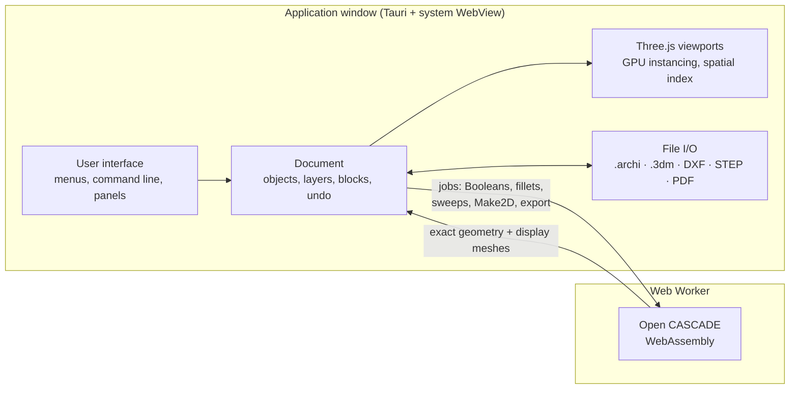

<div align="center">


# ArchiOpen

**An open-source NURBS modeler for architecture.**

Exact curves, surfaces and solids, 2D drawings and layout sheets, rendering, and Rhino, STEP and DXF
interoperability, in a lightweight desktop application driven by a command line.

**English** · [Español](README.es.md)

[](https://github.com/paugavilan8/ArchiOpen/actions/workflows/ci.yml)
[](https://github.com/paugavilan8/ArchiOpen/actions/workflows/desktop.yml)


[](LICENSE)

[Download](#download) · [Getting started](docs/getting-started.md) · [Features](#features) · [Architecture](#architecture) ·
[File formats](#file-formats) · [Roadmap](#roadmap) · [FAQ](#faq) · [Development](#development)

<br>


</div>

## Overview

ArchiOpen follows the workflow of professional NURBS modelers. You type a command (`Line`, `Loft`,
`BooleanDifference`, `Make2D`, …) or pick it from a menu or toolbar, and the program prompts for
points, options and distances. Geometry is exact: curves are NURBS, and surfaces and solids are
boundary representations from the [Open CASCADE](https://dev.opencascade.org) kernel. Models
exported to Rhino or STEP therefore arrive as surfaces, not meshes.

**Highlights**

- **Modeling:** NURBS curves (rational included), sweeps, lofts, network surfaces, patches and
  blends; Boolean operations, fillets and shells; construction history that rebuilds surfaces when
  their input curves change.
- **Building elements:** parametric walls, slabs, windows and doors on levels, made again when their
  lines or parameters change.
- **Precision drafting:** object snaps (End, Mid, Cen, Int, Perp, Tan, …), typed coordinates,
  ortho, construction planes and a gumball.
- **Drawings:** hidden-line `Make2D`, associative dimensions, hatches, linetypes and print widths,
  layout sheets with title blocks, vector PDF and DXF output.
- **Rendering:** physically based materials and textures, sun and shadows, ambient occlusion, and
  images up to 4K.
- **Interoperability:** Rhino `.3dm` with exact surfaces and blocks, STEP AP242, DXF with layers,
  blocks and dimensions, STL, OBJ and glTF.
- **Performance:** the geometry kernel runs in a background worker, picking uses a spatial index,
  and block instances are drawn with GPU instancing.

<table>
<tr>
<td width="50%"></td>
<td width="50%"></td>
</tr>
<tr>
<td align="center"><sub>Four viewports, gumball and properties panel</sub></td>
<td align="center"><sub>A3 layout sheet with a hidden-line isometric detail</sub></td>
</tr>
<tr>
<td colspan="2"></td>
</tr>
<tr>
<td colspan="2" align="center"><sub>A horizontal clipping plane turns the view into a 3D floor plan, with sections filled in each material's color</sub></td>
</tr>
</table>

## Download

> [!NOTE]
> The installer is self-contained: the user interface, the geometry kernel and the Rhino file
> reader are all bundled into the executable. See [What does the installer include?](#installer)

**[Download the latest version](https://github.com/paugavilan8/ArchiOpen/releases/latest)** from the
Releases page (no GitHub account needed):

| System | File |
| --- | --- |
| Windows | `ArchiOpen_x.y.z_x64-setup.exe` (or the `.msi`) |
| macOS | `ArchiOpen_x.y.z_aarch64.dmg` |
| Linux | `ArchiOpen_x.y.z_amd64.AppImage` (or the `.deb` or `.rpm`) |

What is new in each version is in the [changelog](CHANGELOG.md).

**Updates.** From version 0.8.1 the desktop app updates itself: a little after start it looks for a
newer release and offers to install it (Help > Check for Updates looks any time). Updates are
signed, and the app checks the signature before installing.

**First start.** The installers are not yet signed with a code-signing certificate, so Windows may
show "Windows protected your PC" (choose *More info* > *Run anyway*), and macOS may refuse to open
the app the first time (right-click it > *Open*, or allow it in System Settings > Privacy &
Security).

Releases are built and published by GitHub Actions on their own when a change to the version in
`package.json` is merged into `master` (the tag `vX.Y.Z` is made then); pushing such a tag also
publishes one. Builds of the latest code can also be run by hand
from the [**Desktop app**](https://github.com/paugavilan8/ArchiOpen/actions/workflows/desktop.yml)
workflow (**Run workflow**); they appear as artifacts of the run, which need a GitHub account.

## Features

Expand a section for details.

<details>
<summary><b>Interface and viewports</b></summary>
<br>

- Four viewports (Top, Front, Right, Perspective) with grid, axis gizmo and a per-viewport menu.
- Orbit (right mouse button in Perspective), pan (Shift + right button, or middle button) and
  wheel zoom.
- Display modes per viewport: `Wireframe`, `Shaded`, `Ghosted` (translucent surfaces), `X-Ray`
  (hidden edges show through) and `Rendered`, from the viewport menu or `SetDisplayMode`.
- `CPlane` sets the active viewport's construction plane: a new origin, `3Point`, `Elevation` or
  `World`. Everything drawn afterwards uses that plane.
- `NamedView` and `NamedCPlane` save and restore views and construction planes; the *Views* panel
  lists them.
- **Clipping planes** (`ClippingPlane`, *View* menu): everything in front of the plane is hidden,
  as in a section or a 3D floor plan. The arrow shows the visible side and `Flip` reverses it. Cut
  solids are capped in their material's color. Planes can be moved, rotated and copied like any
  object, and the cut updates live. Each plane can be enabled per viewport in the properties panel,
  and `EnableClippingPlanes` / `DisableClippingPlanes` toggle all planes in the active viewport.
  Geometry that is clipped away cannot be picked or snapped to. Clipping planes also cut drawings:
  `Make2D` (the planes on in the active viewport, option `Clipping`), layout details (option
  *Clipping* in the detail panel) and printed views. Cut lines go on their own layer,
  *Make2D Section*, and print with a heavier pen; in plans and sections, the cut faces of solids
  are filled (*Make2D Section Fill*, option `SectionFill`).
- Selection by click, window (left to right) and crossing (right to left), backed by a spatial
  index so it stays immediate in models with thousands of objects or very dense meshes.
- Gumball on the selection: arrows to move, arcs to rotate (Shift snaps to 15°), boxes to scale
  along one axis (Shift scales uniformly) and the center to move in the plane. Clicking a handle
  without dragging prompts for an exact value.
- Layers with color, visibility and locking; a properties panel for the selected object.

</details>

<details>
<summary><b>Precision drafting</b></summary>
<br>

- Typed coordinates: absolute `x,y,z`, relative `r dx,dy`, and a fixed length by typing a number
  before clicking.
- Object snaps, toggled from the status bar (F3 turns them all on or off):
  - `End`, `Mid`, `Cen`, `Quad` and `Near`;
  - `Knot`: the knots of NURBS curves;
  - `Int`: where two curves, edges or mesh lines cross. When they truly intersect the point is
    exact, not taken from the display polylines; when they only cross on screen, the point on the
    first one is used;
  - `Perp` and `Tan`: the point on a curve where the line from the previous point is perpendicular
    or tangent, exact on lines, arcs, circles and NURBS curves.
- Ortho (F8) and grid snap (F9).
- Dragging a selected object or control point moves it, with object snaps.
- Control points: `PointsOn` (F10) and `PointsOff` (F11) on polylines and curves; points can be
  selected, dragged, moved with the gumball or deleted.

</details>

<details>
<summary><b>Curves, points and transforms</b></summary>
<br>

- Drawing: `Line`, `Polyline`, `Rectangle`, `Circle`, `Arc`, `Curve` (control points),
  `InterpCrv` (through points), `Ellipse` (exact, as a rational curve), `Polygon` (inscribed or
  circumscribed) and `Helix`. Rational curves are read and written exactly in `.3dm`, DXF and the
  kernel.
- Curve editing: `Trim`, `Split`, `Join`, `Explode`, `Offset`, `Fillet`, `FilletCorners`,
  `Chamfer`, `Extend`, `BlendCrv` (position, tangency or curvature continuity) and `Rebuild`
  (reports the deviation from the original).
- `CurveBoolean`: click inside the regions curves enclose to get their outline: regions next to
  each other merge, so it gives unions, differences and intersections of closed curves, and
  splits regions with open curves.
- Points: `Point`, `Points`, and `Divide` (by number of segments or by length); `SelPt` selects
  them.
- Transforms: `Move`, `Copy`, `Rotate`, `Scale`, `Mirror`, `Array` and `ArrayPolar`, plus:
  - `Scale1D` stretches along one direction and `Scale2D` in the construction plane only. Surfaces
    and solids stretch too, exactly: their NURBS are stretched with them (a sphere becomes an
    egg, a cylinder an elliptic one), and so does the gumball's scale handle along one axis;
  - `ArrayCrv`: copies along a curve, by number or by distance, turning with it (`Freeform`),
    upright about the construction plane's normal (`Roadlike`) or not at all;
  - `ProjectToCPlane`: flattens curves, points, meshes, texts and hatches onto the construction
    plane;
  - deformations: `Twist` (about an axis, by an angle), `Taper` (from one scale to another along an
    axis), `Bend` (along a spine into an arc of the same length) and `Flow` (from along a base curve
    to along a target curve, stretched to it or not). They work on curves, points, meshes,
    surfaces and solids; surfaces and solids keep their NURBS form, refined and fitted so they
    follow the deformation closely (a twisted or bent bar keeps its volume to within 1e-6).
    `CageEdit` puts objects in a cage of points (2 to 6 a side): move the points and the objects
    follow smoothly; delete the cage to leave them as they are.

  And tools to place objects relative to others (*Transform* menu):
  - `Orient`: moves a reference point onto a target point and, given a second pair, rotates the
    reference line onto the target line, in 3D. Options `Copy` and `Scale` (`No`, `Uniform`, or
    `OneDirection` to stretch along the line only).
  - `Orient3Pt`: places objects from three reference points onto three target points (origin,
    direction and plane) without deforming them.
  - `Align`: aligns objects by their bounding boxes (`Left`, `Right`, `Top`, `Bottom`,
    `HorizontalCenter`, `VerticalCenter`, `Center`) with each other or with a point. Groups move as
    a unit.
  - `Distribute`: spaces three or more objects along X, Y or Z by centers or by equal gaps, either
    between the outermost two or at a fixed spacing.

</details>

<details>
<summary><b>Surfaces, solids and history</b></summary>
<br>

- Solids and surfaces: `Box`, `Cylinder`, `Sphere`, `Cone`, `TCone` (truncated), `Torus`,
  `Pyramid` (any number of sides), `ExtrudeCrv` (with a `Solid` option),
  `Revolve`, `Loft`, `PlanarSrf`, `BooleanUnion`, `BooleanDifference`, `BooleanIntersection`,
  `FilletEdge`, `ChamferEdge`, `Sweep1`, `Shell`, `Section` and `Contour`. `Explode` splits a polysurface into
  faces and `Join` joins them again.
- Advanced surfaces:
  - `Sweep2`: sweeps profiles along two rails, interpolating between several profiles;
  - `NetworkSrf`: a surface from a network of curves in two directions;
  - `Patch`: a surface fitted to a closed boundary and the curves inside it;
  - `EdgeSrf` (from two to four edge curves) and `SrfPt` (from three or four corners);
  - `BlendSrf`: a transition surface between the edges of two surfaces, tangent to both;
  - `FilletSrf`: a constant-radius fillet between two surfaces or faces, on the sides picked, with
    an option to trim both back to it. The surfaces need not touch;
  - `MatchSrf`: changes a surface near one of its edges so that it meets an edge of another
    surface with `Position`, `Tangency` or `Curvature` continuity (a trimmed face is matched over
    its whole surface);
  - `ExtendSrf`: makes a surface longer past the edge picked, carrying on as it goes (a plane
    stays a plane, a cylinder bends round its circle);
  - `Pipe`: a pipe along curves, with start and end radii and an option to cap it as a solid;
  - `RailRevolve`: a profile revolved about an axis while one of its ends follows a rail curve,
    for domes and roofs on oval or irregular plans.
- Surface editing:
  - `Split` and `Trim` work on surfaces, polysurfaces and solids, with curves (projected as seen in
    the viewport) or with other surfaces and solids. Solids split into solids.
  - `Cap`, `ExtrudeSrf`, `OffsetSrf` (with a `Solid` option) and `ExtractSrf`.
  - `Untrim` removes the holes of a face (`HolesOnly`) or every trim, back to its whole surface;
    the rest of a polysurface is joined back to it.
  - `UnrollSrf` flattens planar, cylindrical and conical faces into cutting patterns (outlines in
    the XY plane, with lengths preserved). Faces that share a straight edge stay joined as a folding
    net; with `Explode` every face is laid out on its own. Other faces are skipped and reported.
  - Curves from surfaces: `Project`, `Pull`, `Intersect`, `DupBorder` and `DupEdge`.
- Construction history (on by default, like Rhino's *Record History*): surfaces made with
  `ExtrudeCrv`, `Revolve`, `Loft`, `Sweep1`, `Sweep2`, `Pipe`, `PlanarSrf`, `EdgeSrf`,
  `NetworkSrf` and `Patch` rebuild when their input curves are moved or edited, in the same undo
  step. `SelChildren`, `SelParents` and `HistoryPurge` are available.

</details>

<details>
<summary><b>Building elements</b></summary>
<br>

- `WallType` (or the `Type` option of `Wall`) gives walls a build-up of layers, from their left face
  (looking along their line) to their right one: brick cavity (facing brick, insulation, hollow
  brick, plaster), insulated concrete, partition or timber frame. The wall is split into one solid
  per layer, so plans and sections draw the lines between them, and the quantities measure each
  layer by its material.
- `CurtainWall` draws a glazed wall along a line point by point, as high as the current level:
  mullions at most `Spacing` apart, transoms at most `Rows` apart (`Mullion` and `Depth` size
  them) and glass between. Its frame and glass are two objects made from the same line, and are
  made again when it changes; IFC export writes them as one IfcCurtainWall.
- `Wall` draws walls point by point (`Close` for a room) or along curves already drawn (`Curve`),
  with `Thickness` and `Justification` (`Center`, `Left` or `Right` of the line). Corners are
  mitred and curved lines give curved walls. Walls take the height of the current level.
- Walls join by themselves: two walls whose ends meet are mitred into a clean corner (L), and a
  wall ending on another one (on its line or at its face) stops at that face (T), whatever their
  thickness and justification. Joins follow when either wall moves or changes, and undo with it.
- `Slab` makes a floor or roof slab from corner points or closed curves, with its top on the
  outline and the `Thickness` below it.
- `Roof` makes a pitched roof over an outline drawn at the top of the current level's walls (or
  over closed curves). `Type`: `Hip` (every side slopes), `Gable` (the long sides slope, the ends
  are gables) or `Shed` (one slope); options `Pitch`, `Overhang` and `Thickness`. Convex outlines
  take any type; square-cornered plans such as L, T and U shapes take hip roofs, with valleys at
  their inside corners, and gable roofs, with crossing ridges. The roof rests on the outline (its
  underside is at the eaves height there), and walls under it whose tops are at that height go up
  to its underside, closing gables and following the roof as it changes.
- `Stair` makes a stair from its bottom step to its top one, climbing the current level's height.
  A straight line gives one flight; each bend of the line is a square landing between flights (an
  L stair has one, a U stair two side by side, drawn as a line going up, across and back). Options:
  `Width` and `Risers` (automatic: steps of about 175, shared among the flights by their length).
  It says whether the steps are comfortable (two risers and a tread between 600 and 650). With
  `Opening` (on by default) it cuts its stairwell through the slab it climbs to: its flights and
  landings, 50 larger all round. `StairOpening` cuts it again for stairs picked, and editing a
  level's height makes its stairs again to climb it, with their openings.
- `Column` places rectangular or round columns, as high as the current level.
- `Railing` puts railings along a line drawn point by point (slab edges, balconies) or, with the
  `Stair` option, on stairs: up the steps' noses of each flight (`Sides` `Both`, `Left` or
  `Right`) and round the free edges of the landings. They have posts at most 1200 apart, a handrail
  at `Height` and `Style` `Bars` (upright bars) or `Rails` (three level rails), in brushed steel on
  a *Railings* layer. Railings on a stair follow it when its line or parameters change.
- `Window` and `Door` cut openings where a wall is clicked, with `Width`, `Height` and `Sill`, and
  fill them: windows get a frame and glass, doors a frame and a leaf, each with its own material on
  the *Windows*, *Glazing* and *Doors* layers (`Frame=No` leaves a bare opening). They stay with
  their wall when its line moves or its parameters change, and go when the opening is removed.
- Openings are also drawn in plan, on a *Plan Symbols* layer at the floor: a door's leaf open
  square to the wall with the arc it sweeps, a window's frame and glass. A door opens to the side of
  the wall it was clicked on, hinged at the end set by `Hinge`; the Properties panel turns it to
  the other side (⇅) or hangs it on the other end (⇄).
- Walls and slabs keep their line (on the *Construction* layer): moving or editing it makes them
  again. Thickness, height, justification and openings (and the parameters of roofs, stairs and
  columns) can be changed in the Properties panel, as one undo step. Moving the solid itself turns it into a plain solid, as with construction history.
- `WallDimensions` dimensions walls in plan, as on an architectural drawing: along the outside
  face of each straight stretch of the outside walls, a chain from corner to corner through the
  edges of the openings and, further out, the overall length (inside walls are left alone). The
  dimensions use architectural ticks, go on a *Dimensions* layer and are grouped.
- `Room` labels rooms: click inside one to get its outline (between the walls' plan outlines,
  around any columns, ignoring openings) on a *Rooms* layer and a label with its name and floor
  area (m² or ft² by the document's units) centred where you clicked, grouped. The outline can
  make the room's floor with `Slab` (`Curve` option). Open rooms are reported.
- `Floor` lays a floor finish in rooms clicked inside (or on closed curves): `Thickness` and
  `Material` (`Wood`, `CeramicTiles`, `Marble`, `Concrete`), round any columns. `Skirting` runs a
  skirting board round rooms, along the walls and round columns, broken at doors, with `Height` and
  `Thickness`. Both keep their outline on the *Construction* layer and their parameters in the
  Properties panel.
- `Furniture` places furniture and fittings from a small library: `DoubleBed`, `SingleBed`,
  `Sofa`, `Armchair`, `DiningTable`, `Chair`, `Desk`, `Wardrobe`, `KitchenCounter`, `Fridge`, `WC`,
  `Washbasin`, `Bathtub` and `ShowerTray`. Each is made into a block the first time it is used and
  placed by the middle of its back (against a wall), then turned to face a point or an angle;
  bathroom fittings go on a *Sanitary* layer in ceramic.
- `Elevations` draws the four elevations of the building (south, east, north and west) in a row
  under the model, and `Section` draws a section along a line drawn in plan, looking to the side
  picked, with its cut walls, slabs and roofs heavier and filled, beside the model. Each view gets
  a ground line and a title and is grouped, ready for layout details; a section also gets its
  mark in plan (the cut line, arrows and letters A, B, ...). Each view also gets its heights: a
  level mark (name and height, ±0.00 at zero) at each level and at the top on the left, and on the
  right a chain of dimensions through the sills and heads of the openings it shows and another
  from level to level.
- `Schedule` draws the doors and windows table (one row per type, marked D1, D2, ... and W1,
  W2, ..., with width, height, sill, levels and count) and the rooms table (each labelled room with
  its level and floor area, the total of each level and of the building) on a Schedules layer,
  ready for layout details. `UpdateDrawings` makes them again in place from the model. Its
  `Quantities` option draws the quantities of the building's elements by level and material:
  walls (length and the area of one face less openings), slabs (area less openings), roofs (plan
  area), columns, stairs, railings (length), floor finishes, skirting, doors and windows, with
  their volumes, in meters. `ExportQuantities` writes them to a CSV file for a spreadsheet.
- `Tags` places the mark of each door and window (D1, W1, ... as in the doors and windows
  schedule) beside it in plan, on an Opening Tags layer; `UpdateDrawings` places them again and
  `DrawingSet` adds them if missing. On the plans of a drawing set, texts such as room labels,
  tags and dimensions show on their own level's plan only; section marks show on every plan.
- `DrawingSet` lays the building's drawings out on A3 sheets in one go, each with its title block
  (project name, drawing title, number A-01, A-02, ..., scale and date): a plan of each level with
  something in it, cut 1.2 above its floor and without the levels under it (all at one scale, with
  hidden lines and filled cuts), the four elevations (drawn first if missing), the sections and
  the schedules (also drawn first if missing). Each sheet picks the largest standard scale that
  fits, and the sheets are ordinary layouts, to adjust or export to PDF. Each plan detail is cut
  only by its own level's clipping planes, which cut no view on screen. `UpdateDrawings` draws the
  elevations, sections and schedules again from the model as it is, each in its place, so the
  sheets show the changes.
- `Terrain` makes the site's ground through point objects and contour lines (curves at their
  heights, sampled every `Spacing`), as a mesh on a Terrain layer: the Delaunay triangulation of the
  points in plan, each at its height. `Boundary` cuts it to a closed curve, `MaxEdge` leaves out
  long triangles at concave edges, and `Base` gives it sides and a bottom some depth below its
  lowest point, so it is a solid that sections cut and fill.
- `Level` adds, edits and removes levels (name, elevation and floor-to-floor height) and sets the
  current one, which moves the construction planes to its elevation. Levels are saved with the
  model.
- They are ordinary solids for everything else: clipping planes cut them into plans and sections
  with filled cuts, and `Make2D`, layouts, rendering and export work as for any solid.

</details>

<details>
<summary><b>Meshes</b></summary>
<br>

- `Mesh` converts surfaces and solids to meshes (`Coarse`, `Medium` or `Fine`); `MeshBox`,
  `MeshSphere`, `MeshCylinder` and `MeshPlane` create meshes with a given number of faces.
- Editing: `Weld`, `Unweld`, `Flip`, `UnifyMeshNormals`, `FillMeshHoles`, `Join` and `Explode`.
  Vertices can be edited as control points.
- `MeshToNURB` converts a mesh into a polysurface of planar faces (a solid when closed).
- Meshes are shaded smoothly with sharp creases; the properties panel shows vertices, faces,
  closedness, area and volume.
- `Make2D`, `Section` and `Contour` work on meshes too.

</details>

<details>
<summary><b>Analysis</b></summary>
<br>

- Measurement: `Distance`, `Length`, `Angle`, `Radius`, `Area` and `Volume` (with centroids).
  Surface and solid measurements are exact for planar, cylindrical, conical, spherical, toroidal,
  low-degree B-spline and extruded faces.
- `BoundingBox` in world or construction-plane coordinates.
- `CurvatureGraphOn` / `CurvatureGraphOff`: curvature combs that update as curves are edited.
- `Zebra` and `DraftAngleAnalysis` shading for surfaces and meshes; `ShowEdges` highlights naked
  edges.
- `What` describes objects; `Check` reports invalid geometry, non-manifold edges, degenerate faces
  and zero-length curves; `SelBadObjects` selects them.

</details>

<details>
<summary><b>Rendering and materials</b></summary>
<br>

- `Rendered` display mode: physically based materials with studio reflections, a sun with soft
  shadows and a ground shadow under the model. Objects without a material show as a matte clay
  model, tinted lightly by their layer color.
- Materials from presets (plaster, concrete, wood, brick, tiles, marble, steel, glass, water, …),
  editable color, roughness, metalness and transparency, assigned to objects or layers.
- Textures: procedural patterns (`Wood`, `Brick`, `Tiles`, `Concrete`, `Marble`) or images
  (JPEG, PNG, WebP), applied with box mapping at their real-world size.
- `Sun`: azimuth, altitude, intensity, background and ground shadows.
- `Render` produces images at 1280 × 720, 1920 × 1080, 3840 × 2160 or viewport size, with
  antialiasing and ambient occlusion. `ViewCaptureToFile` saves the viewport as displayed.

</details>

<details>
<summary><b>Drawings, dimensions and layouts</b></summary>
<br>

- `Make2D` projects the selection with hidden-line removal into flat curves: plans, elevations
  and axonometric views, or four views at once (`FourView`), optionally including hidden lines.
  With clipping planes it draws plans and sections: solids are cut and their cut outlines go on the
  *Make2D Section* layer.
- Text and dimensions drawn with a single-stroke technical font: `Text`, `Dim`, `DimAligned`,
  `DimRadius`, `DimDiameter`, `DimAngle` and `Leader`, with arrowheads or architectural ticks.
  Dimensions update when their geometry changes, and their text, height and precision are editable
  in the properties panel.
- `Hatch` fills closed planar curves (inner curves become holes) with a solid fill or a pattern.
- Linetypes and print widths per layer.
- `ExportPDF` prints the active viewport to vector PDF at a given paper size and scale;
  `ExportDXF` writes DXF R12.
- Layout sheets (`Layout`): detail views with their own view, scale and display mode (wireframe or
  hidden-line), captions and a title block. Hidden lines are recomputed only when what a detail
  shows changes. `ExportPDF` prints one sheet or all of them as a multi-page PDF.

</details>

<details>
<summary><b>Blocks, groups and organization</b></summary>
<br>

- Blocks: `Block`, `Insert`, `BlockEdit` (in-place editing that updates every instance, nested ones
  included), `Explode` and `Purge`. The *Blocks* panel lists definitions with thumbnails and
  instance counts. Instances are drawn with GPU instancing, so hundreds of copies cost about the
  same as one.
- Linked files, to work on a project in parts (as worksessions or external references): `Link`
  places another model (`.archi` or `.3dm`) in this one as a block tied to its file, with its
  layers under the file's name; `UpdateLinks` reads the files again after they change; `Unlink`
  makes them part of this model. Linked blocks cannot be edited here (change their file), and their
  content is saved too, so the model still shows them if a file goes missing. The desktop app reads
  linked files again by their path; in the browser, only during the session they were linked in.
- Groups: `Group`, `Ungroup`, `AddToGroup` and `RemoveFromGroup`.
- `Hide`, `Show`, `HideSwap`, `Isolate`, `Unisolate`, `Lock` and `Unlock`.
- Selection commands: `SelCrv`, `SelSrf`, `SelPolysrf`, `SelClosedPolysrf`, `SelOpenPolysrf`,
  `SelBlockInstance`, `SelAnnotation`, `SelDim`, `SelText`, `SelHatch`, `SelLayer`, `SelDup`,
  `SelLast`, `SelPrev` and `Invert`.
- **Copy and paste** (*Edit* menu): `Ctrl+C`, `Ctrl+X` and `Ctrl+V` (`CopyToClipboard`, `Cut`,
  `Paste`) carry objects through the system clipboard, between windows and files, together with
  their layers, materials, groups and blocks. Pasted objects keep their position and are scaled
  when the target file uses different units.

</details>

<details>
<summary><b>Files</b></summary>
<br>

- **ArchiOpen's folder** (desktop app): in the local application data, never a synced folder
  (`AppData\Local\ArchiOpen` on Windows, `~/Library/Application Support/ArchiOpen` on macOS,
  `~/.local/share/ArchiOpen` on Linux). It holds `Templates`, `Scripts` (the example scripts, to copy
  and change) and `Autosave`.
- **Templates:** `NewFromTemplate` starts a model from one (an *Architecture* template with levels and
  the usual layers comes with the app); `SaveAsTemplate` keeps the model, with its layers, levels,
  materials and layouts, as a new one.
- **Project folder:** Open and Save start in the folder last used; `ProjectFolder` sets the one they
  start in (a local or network folder).
- `.archi` (JSON) is the native format. The session is recovered automatically if the application
  closes unexpectedly.
- **Autosave to a folder** (desktop app, `Autosave`, *File* menu): every 5 minutes, while there are
  unsaved changes, a copy of the model goes to the local application data, never a synced
  folder like OneDrive (`AppData\Local\ArchiOpen\Autosave` on Windows,
  `~/Library/Application Support/ArchiOpen/Autosave` on macOS, `~/.local/share/ArchiOpen/Autosave` on
  Linux), as
  `<name> <date> <time>.archi`. The newest 10 copies of each model are kept. The interval, the
  number of copies and the folder are options; `SaveNow` writes a copy at once and `Recover` lists
  the copies and opens one as an unsaved model.
- **Rhino `.3dm`** (via [rhino3dm](https://github.com/mcneel/rhino3dm)):
  - Reading: curves, polysurfaces, surfaces and extrusions (rebuilt as exact, editable geometry
    with trims and holes), meshes, points, layers, units, blocks (including nested blocks and
    blocks containing polysurfaces) and text. Formatting of text is not preserved. SubD objects,
    dimensions, leaders and text dots are not read yet; the number skipped is reported.
  - Writing: surfaces and solids are exported exactly as trimmed Rhino polysurfaces (planes,
    surfaces of revolution, extrusions and NURBS), blocks as Rhino block definitions written once,
    and nested layers. Geometry without an exact equivalent is written as a mesh, and the export
    reports it. Text and dimensions are written as curves.
  - `Save` never overwrites an opened `.3dm`; it saves an `.archi` file instead.
- **STEP** (AP242): `ExportSTEP` writes exact solids, surfaces and curves with layer names, colors
  and units; `ImportSTEP` reads them into the current layer, converted to the model's units.
- **DXF** (ASCII, R12 to 2018): layers with color, linetype and lineweight; lines, polylines with
  arcs, circles, arcs, ellipses, splines, 3D faces, text, dimensions (kept associative), leaders,
  hatches and blocks (kept as blocks). Binary DXF is not supported.
- **DWG** (desktop app): `Open` and `Import` read DWG drawings through the free
  [ODA File Converter](https://www.opendesign.com/guestfiles/oda_file_converter), installed apart:
  ArchiOpen finds it, turns the drawing into DXF in the background and reads that. DWG is a closed
  format; this keeps ArchiOpen free of its licences. If the converter is installed somewhere else,
  set `ARCHIOPEN_ODA_CONVERTER` to its path.
- **STL** and **OBJ** import and export.
- **glTF** (`.glb`) export with `ExportGLTF`: surfaces, solids, meshes and blocks with their render
  materials, in meters with Y up, for web viewers, Blender, Unreal, Unity, Twinmotion and AR.
- **IFC** (IFC4), for BIM tools such as Revit, ArchiCAD or BIMcollab:
  - `ExportIFC` writes a project with a site, a building and a storey per level. Walls, slabs,
    roofs, stairs, columns, railings, floor finishes and skirting become their IFC entities, and
    each door and window one IfcDoor or IfcWindow with its size. Furniture becomes IfcFurniture,
    rooms become spaces with their floor area, and anything else a proxy. Shapes are written as
    triangulated faces, in meters. A wall drawn as a ring or along several segments is written as
    one wall for each side, mitred at the corners.
  - `Open` and `Import` read IFC files (through [web-ifc](https://github.com/ThatOpen/engine_web-ifc)).
    Straight walls of even thickness become ArchiOpen walls on their centre lines, joined where
    they meet, with the doors and windows in them as their openings (frames and glass made
    again); flat slabs become slabs on their outlines, with their holes. All are editable as if
    drawn here. Anything else (curved or sloping walls, roofs, furniture, ...) comes in as meshes
    on a layer per class, colored as in the file, with spaces on a hidden layer. `Open` also takes
    the storeys as levels. The message on opening says why any walls or slabs stayed meshes.
    Tested with ArchiCAD's FZK-Haus (9 of its 13 walls editable, the rest gables) and a Revit
    sample (16 of 17).

</details>

<details>
<summary><b>Scripts</b></summary>
<br>

`RunScript` (*File* menu) runs a JavaScript file that drives the modeler, to automate repetitive
work; `Last` runs the last one again. A script runs as the body of an async function, with
`archi` and `Vector3` in scope:

| | |
| --- | --- |
| `await archi.command(name, ...answers)` | Runs a command with its answers in order (`''` is Enter; when they run out, Enter until it ends). Resolves to the ids it left selected (what it made); a command error stops the script. |
| `archi.add(geometry, layer?)`, `archi.remove(ids)` | Adds geometry (a curve, mesh or point) to a layer by name, or deletes objects. |
| `archi.objects(filter?)` | The objects: id, type, layer, and the command and parameters of those with history. |
| `archi.select(ids)` | Selects objects, for commands that act on the selection. |
| `archi.setParams(id, params)` | Changes the parameters of an object made with history (a wall's `openings`, `thickness` or `height`, ...); it is made again, as from Properties. |
| `archi.levels()`, `archi.setLevel(name)` | The levels, and the current one: points typed in commands are measured from its floor (`w` before a point, as `w0,0,6400`, gives world coordinates). |
| `await archi.step(edits)` | Several edits as one undo step. |
| `archi.v(x, y, z)`, `archi.log(...)`, `archi.doc` | A point, a line in the history, and the document itself. |
| `archi.param(name, value, { min, max, step })` | A parameter, with a slider when run with `Parametric`. |

`Parametric` (*File* menu) runs a script whose parameters get sliders in a small panel: let go of
a slider and what the script made is made again with the new value, as one undo step, in the
spirit of visual programming tools. `Bake` keeps the result as ordinary objects and `Discard` takes
it away.

Examples are in [examples/scripts](examples/scripts): a grid of columns, a tower of several levels
and a twisting tower with sliders for its floors, size and twist. Scripts have the same access as the application: run only those you trust.

</details>

<details>
<summary><b>AI assistant (MCP)</b></summary>
<br>

ArchiOpen can be driven by Claude, or any other [MCP](https://modelcontextprotocol.io) client:
ask in plain words for a building or its drawings, and the assistant runs the commands in your
model, looks at an image of the result and corrects it. The [MCP server](mcp/README.md) runs on
your computer; turn the connection on in the app with `McpConnect` (*File > Connect AI
Assistant*), and the status bar shows when an assistant is connected. Its tools describe the
model, run commands and scripts, change elements' parameters, capture views, open, save and
export files (IFC, PDF, DXF, quantities) and undo. See [mcp/README.md](mcp/README.md) to
set it up in Claude Desktop or Claude Code.

</details>

<details>
<summary><b>Other commands and aliases</b></summary>
<br>

- `PointsOn`, `PointsOff`, `Delete`, `SelAll`, `SelNone`, `Undo`, `Redo`, `Zoom`, `MaxViewport`,
  `Snap`, `Ortho`, `Osnap`, `Units`, `New`, `Open`, `Save`, `SaveAs`, `Import`, `Export`,
  `ImportSTEP` and `ExportSTEP`.
- Aliases: `M`, `RO`, `SC`, `MI`, `AR`, `AP`, `TR`, `J`, `X`, `OF`, `F`, `REC`, `A`, `U`, `Z`,
  `ZE`, `ZEA`, `ZS`, `EXT`, `REV`, `BU`, `BD`, `BI`, `FE`, `SW`, `H`, `B`, `I`, `G` and `UG`.

</details>

## Architecture



- **Commands** are small asynchronous functions that prompt for points, objects or options and
  edit the document. Each command is a single undo step.
- **Document.** Curves are NURBS evaluated in TypeScript. Surfaces and solids are stored in Open
  CASCADE's exact format, together with a mesh used only for display.
- **Geometry kernel.** Heavy operations run in a Web Worker with Open CASCADE compiled to
  WebAssembly, so the window stays responsive and `Esc` cancels a long job. Each job releases the
  kernel objects it created, and the worker is replaced transparently if its memory grows too
  large.
- **Viewports.** Three.js renders on the GPU. A two-level bounding volume hierarchy limits picking,
  window selection and object snaps to what is near the cursor.
- **Desktop application.** [Tauri](https://tauri.app) packages everything into a native executable
  that uses the system web engine (WebView2 on Windows), keeping the installer to tens of megabytes.

## File formats

| Format | Open / import | Save / export | Notes |
| --- | :---: | :---: | --- |
| `.archi` | Yes | Yes | Native JSON format: model, layouts, materials and history |
| Rhino `.3dm` | Yes | Yes | Exact surfaces and solids both ways, blocks as blocks, text on import; SubD and dimensions not read yet |
| STEP `.step` `.stp` | Yes | Yes | AP242, exact B-rep, with layers, colors and units |
| DXF | Yes | Yes | ASCII R12–2018: layers, blocks, dimensions, text, hatches |
| DWG | Yes | — | Desktop app, through the free ODA File Converter |
| STL / OBJ | Yes | Yes | Meshes; surfaces are exported triangulated |
| glTF `.glb` | — | Yes | Triangles with render materials, in meters |
| PDF | — | Yes | Vector output with lineweights and linetypes; multi-page layouts |
| PNG | — | Yes | `Render` and `ViewCaptureToFile` |

## Roadmap

- [x] `Int`, `Perp`, `Tan` and `Knot` object snaps
- [x] Live clipping planes with filled sections
- [x] Clipping planes in layouts, `Make2D` and PDF output
- [x] `Orient`, `Orient3Pt`, `Align` and `Distribute`
- [x] Blocks and text from `.3dm`; blocks exported as blocks
- [ ] Dimensions and SubD from `.3dm`
- [x] Copy and paste between files
- [x] `ChamferEdge` and `UnrollSrf`
- [x] `Untrim` and `RailRevolve`
- [x] `FilletSrf` and `MatchSrf`
- [ ] Deformation tools: `Bend`, `Twist`, `Taper`, `Flow`, `Cage`
- [ ] SubD modeling
- [x] Building elements: walls, slabs, windows, doors and levels
- [x] Window and door frames, glass and leaves
- [x] Wall joins (L and T)
- [x] Roofs (hip, gable, shed), straight stairs and columns
- [x] Walls up to the roof
- [x] Stairs with landings (L and U)
- [x] Roofs over L, T and U plans
- [x] Railings for stairs and slab edges
- [x] Automatic plan dimensions for walls and openings
- [x] Room labels with areas
- [x] Door swings and window symbols in plan
- [x] Floor finishes and skirting from room outlines
- [x] Furniture and fittings library (blocks)
- [x] Section and elevation views of the building, ready for layouts
- [x] A drawing set: plans, sections and elevations placed on layout sheets in one go
- [x] Drawings that update from the model (`UpdateDrawings`)
- [x] Level marks and height dimensions on elevations and sections
- [x] Door and window and room area schedules (`Schedule`)
- [x] Several levels in the drawing set, with a plan for each
- [x] IFC export and import
- [x] Stairs that follow their level's height, with stairwells cut in the slab above
- [x] Quantities by element, level and material, with CSV export
- [x] Terrain from contour lines and survey points
- [x] Walls with layers (build-ups)
- [x] Curtain walls
- [x] Scripts (`RunScript`)
- [x] AI assistant through MCP (Claude and other clients)
- [x] Parametric scripts with sliders
- [x] Door and window tags in plan, linked to the schedule
- [ ] Signed installers and automatic updates

## FAQ

<details id="installer">
<summary><b>What does the installer include?</b></summary>
<br>

Everything the application needs. Tauri bundles the user interface, the Open CASCADE kernel (about
23 MB of WebAssembly) and the `.3dm` reader into the executable. The only external dependency is
the system web engine: WebView2 on Windows 10 and 11, which is preinstalled (the installer
downloads it if it is missing). Your models are the `.archi` files you save.

</details>

<details>
<summary><b>Windows will not run the application</b></summary>
<br>

The executable is not code-signed yet. On a personal computer, Windows SmartScreen may show a
warning: choose *More info* → *Run anyway*. On managed computers, policies such as AppLocker often
block unsigned programs installed in the user profile; an administrator has to allow it.

</details>

<details>
<summary><b>Can I work back and forth with Rhino?</b></summary>
<br>

Yes. `Open` and `Import` read `.3dm` files with curves, surfaces, polysurfaces, extrusions,
meshes, blocks, text and layers, and `Export` writes exact surfaces and solids (not meshes) and
blocks as blocks. Anything that cannot be read yet is reported when the file is opened, and `Save`
never overwrites the original `.3dm`.

</details>

<details>
<summary><b>Does it need an internet connection?</b></summary>
<br>

No. Everything runs offline; there are no accounts and no telemetry.

</details>

<details>
<summary><b>Is ArchiOpen affiliated with Rhino or McNeel?</b></summary>
<br>

No. ArchiOpen is an independent project. It follows the workflow and command names common to NURBS
modelers so that it feels familiar, but it uses no code, icons or assets from any other product.
`.3dm` files are read with [rhino3dm](https://github.com/mcneel/rhino3dm) (MIT) and written
following the format documented in the open-source openNURBS toolkit.

</details>

## Development

Requirements: Node 22 and, for the desktop application, Rust and the
[Tauri prerequisites](https://tauri.app/start/prerequisites/) for your platform.

```sh
npm install
npm run dev        # user interface in the browser at http://localhost:5173
npm run app:dev    # desktop application with hot reload
npm run app:build  # installers in src-tauri/target/release/bundle
npm run typecheck
npm test           # geometry and kernel tests
```

<details>
<summary><b>Project structure</b></summary>
<br>

| Directory | Contents |
| --- | --- |
| `src/core` | Document model, geometry (curves, meshes, dimensions, hatches, blocks), pick index, object snaps |
| `src/math` | NURBS evaluation, knots and weights |
| `src/kernel` | Open CASCADE: loading, Web Worker, jobs, memory management, exact `.3dm` export |
| `src/commands` | Commands, grouped by topic |
| `src/input` | Mouse and keyboard handling, point requests and object snaps |
| `src/view` | Three.js viewports, gumball, display modes, rendering, clipping |
| `src/io` | `.archi`, `.3dm`, DXF, STEP, STL, OBJ, PDF and layout sheets |
| `src/ui` | Menus, toolbars, panels and command line |
| `src-tauri` | Desktop application |
| `mcp` | MCP server for AI assistants (Claude and other clients) |
| `examples/scripts` | Example scripts for RunScript |

</details>

## Credits

- [Open CASCADE Technology](https://dev.opencascade.org) (LGPL 2.1 with exception) through
  [replicad](https://replicad.xyz) (MIT), [Three.js](https://threejs.org) (MIT),
  [rhino3dm](https://github.com/mcneel/rhino3dm) (MIT) and [Tauri](https://tauri.app)
  (MIT/Apache 2.0).
- The test file `src/io/fixtures/rhino-text.3dm.b64` contains two text objects from the
  [rhino3dm](https://github.com/mcneel/rhino3dm) test models (MIT).
- The test file `src/io/fixtures/ezdxf-sample.dxf` was generated with
  [ezdxf](https://github.com/mozman/ezdxf) (MIT).
- Text is drawn with the Hershey fonts (A. V. Hershey, U.S. National Bureau of Standards), as
  converted by [hersheytext](https://github.com/techninja/hersheytextjs) (MIT).

## License

ArchiOpen is released under the [MIT License](LICENSE). Third-party libraries keep their own
licenses; see [Credits](#credits).
